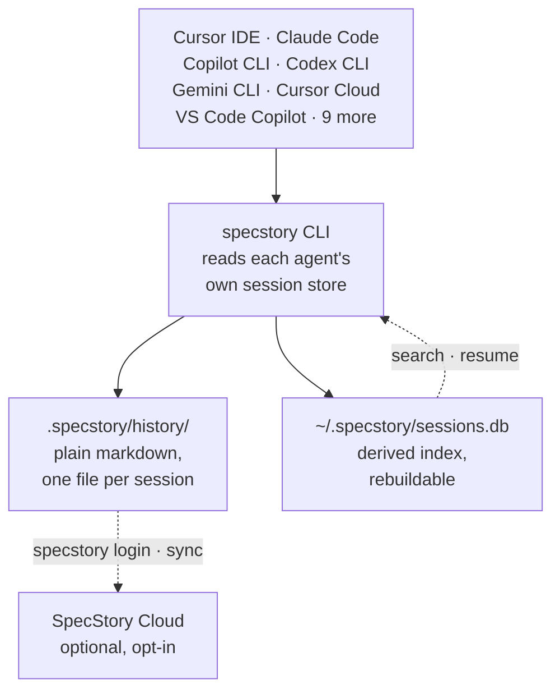
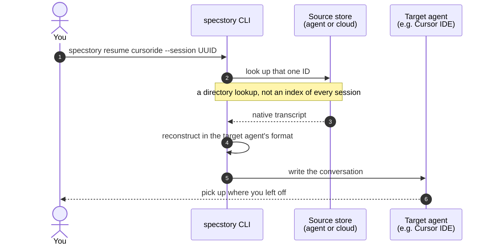

# Intent is the new source code

**One searchable, portable history for every AI coding agent you use.**

SpecStory saves your conversations with Cursor, Claude Code, Copilot, Codex, Gemini and 11 other agents as plain markdown in your repo. Then it lets you find them again, share them, and continue them in a different agent.

<p align="left">
  <strong>Install SpecStory ──▶ </strong>&nbsp;
  <a href="https://specstory.com"></a>
  <a href="https://specstory.com"></a>
  <a href="https://specstory.com"></a>
</p>

<p align="left">
  <strong>Contribute to OSS ──▶</strong>&nbsp;
  <a href="https://github.com/specstoryai/getspecstory/tree/main/specstory-cli"></a>
  <a href="./lore"></a>
</p>

<p align="left">
  <strong>Connect with us ───▶</strong>&nbsp;
  <a href="https://twitter.com/specstoryai"></a>
  <a href="https://www.linkedin.com/company/specstory"></a>
  <a href="https://specstory.slack.com/join/shared_invite/zt-2vq0274ck-MYS39rgOpDSmgfE1IeK9gg#/shared-invite/email"></a>
  <a href="https://discord.gg/E47yQyEUd3"></a>
  <a href="https://www.youtube.com/@specstory"></a>
</p>

## The problem

You have more AI conversations than ever, and less of them to show for it.

| What goes wrong | What it costs you |
| --------------- | ----------------- |
| **The window closes and the context is gone.** Every agent keeps its own private store - Cursor a multi-gigabyte database, Claude Code a folder of JSONL - and none of it lives in your repo. | You re-explain the same architecture, the same constraints, the same decisions, in the next session. |
| **Your agents are islands.** A session started in Cursor CLI cannot be continued in Cursor IDE. Claude Code cannot pick up where Codex stopped. | The agent you want to use next is never the agent that has the context. |
| **The good work never compounds.** The way you actually debug, review, and ship is buried in transcripts nobody reads again. | Your best workflows stay in your head, and every teammate rediscovers them from scratch. |

SpecStory fixes this at the source: **the session becomes a file you own.**

## How it works



Everything local is yours: markdown you can commit, diff, grep, or hand to any tool that reads text. The index is a cache - delete it and it rebuilds. The cloud is opt-in and receives nothing until you log in.

## Capture: no change to how you work

| You want to | Run | What happens |
| ----------- | --- | ------------ |
| Start a session with auto-save | `specstory run claude` | Wraps the agent; markdown is written as you chat. |
| Save the sessions already on disk | `specstory sync` | Renders every past session in this project as markdown. |
| Keep saving while you work elsewhere | `specstory watch` | Watches the project and saves whatever agent is active. |

```zsh
specstory run cursor        # Cursor CLI, saved as you go
specstory run cursoride     # opens the project in Cursor IDE and keeps saving
specstory sync -s <uuid>    # one session, straight from its own store
specstory list cursor       # what is on disk for an agent
```

## Keep: a history you can read, diff, and commit

Every session lands in your repo, named after the moment and the question:

```text
.specstory/history/2026-11-18_00-11-44Z-ship-minor-push-release.md
```

The file is ordinary markdown, so it works with everything you already have:

```markdown
# 2026-11-18 00:11:44Z

_**User (2026-11-18 00:11:44Z)**_

Ship the minor release and push it.

---

_**Agent (claude-opus-5 2026-11-18 00:11:52Z)**_

Pushing the tag now.
```

- **Commit it, or don't.** Each project decides; nothing is sent anywhere without you.
- **Secrets are redacted by default.** API keys, tokens and private keys are stripped before markdown is written or synced.
- **Search it with anything.** `rg`, `git log -S`, your editor, your own scripts.

## Reuse: search it, move it, forge it

### Find any past conversation

```zsh
specstory search docker cache     # full-text across every indexed session
specstory search                  # interactive picker; r resumes, space previews
```

### Continue it in a different agent

This is where your history starts paying you back. Any session can be reconstructed in another agent's native format - Cursor CLI into Cursor IDE, Cursor IDE into the Cursor CLI, anything into anything installed.



```zsh
specstory resume                                    # pick a session, pick an agent
specstory resume cursoride --session <uuid>         # Cursor CLI → Cursor IDE
specstory resume cursor --session <uuid>            # Cursor IDE → Cursor CLI
specstory resume --session <cloud permalink>        # from another machine, via SpecStory Cloud
```

| From | To | How |
| ---- | -- | --- |
| Any local session | Any installed agent | `specstory resume <agent> --session <uuid>` |
| This machine | Another machine | Sync, then resume the cloud permalink there |
| SpecStory Cloud | Local agent | `specstory resume --session specstory://…` (login + Pro) |

Three things worth knowing:

- **Session IDs come from `specstory list`**, or from the Resume button in SpecStory Cloud.
- **No index is required.** The session is looked up by ID in its own provider's store, so this works on a machine that has never built an index. Browsing and searching are the only things that need one.
- **Run it from the project the session should belong to.** A session resumed into Cursor IDE is registered under the directory you are standing in.

The conversation crosses as turns of text. Tool calls appear as readable records (`Tool use: **Shell** …`) rather than interactive tool blocks.

### Forge skills from your own history

[**Lore**](./lore) mines your `.specstory/history` for the workflows you actually repeat, proves them with evidence and outcomes, and forges the ones you approve into skills installed across every agent on your machine.

```zsh
npx skills add specstoryai/getspecstory --skill lore
```

Then invoke it - `/lore` in Claude Code, `$lore` in Codex, or just ask in Gemini CLI and others. SpecStory Cloud can also mine synced sessions into skills you browse and install with `specstory skills` (login + Pro).

## Install

macOS and Linux:

```zsh
curl -fsSL https://raw.githubusercontent.com/yaogjim/getspecstory/dev/install.sh | bash
```

Windows: download the archive from [Releases](https://github.com/yaogjim/getspecstory/releases/latest).

From source:

```zsh
git clone https://github.com/yaogjim/getspecstory
cd getspecstory/specstory-cli && go build -o specstory
```

> [!NOTE]
> `brew tap specstoryai/tap && brew install specstory` installs the upstream SpecStory build. Releases in this repository can be ahead of it - v2.17.2 here carries the Cursor CLI transcript and direct-resume fixes.

## Quick start

```zsh
specstory check                  # which agents are installed, and what SpecStory can read
specstory run claude             # launch an agent with auto-save
specstory sync                   # turn this project's past sessions into markdown
specstory search docker cache    # find a past session by its content
specstory resume                 # continue one, in this or another agent
specstory login                  # optional: back up and search across machines
```

All sessions save to `.specstory/history/` in the current project.

## Supported agents

| Agent | Type | SpecStory reads |
| ----- | ---- | --------------- |
| [Cursor IDE](https://cursor.com/) | IDE | `Cursor/User/globalStorage/state.vscdb` |
| [Cursor CLI](https://cursor.com/cli) | CLI | `~/.cursor/chats/` plus the per-session JSONL transcript |
| [Cursor Cloud Agents](https://cursor.com/agents) | Cloud | Cursor API (`CURSOR_API_KEY`) |
| [Claude Code](https://claude.ai/claude-code) | CLI | `~/.claude/projects/` |
| [GitHub Copilot in VS Code](https://github.com/features/copilot) | IDE | `Code/User/workspaceStorage/*/chatSessions/` |
| [Copilot CLI](https://github.com/features/copilot/cli) | CLI | `~/.copilot/session-state/` |
| [Codex CLI](https://www.openai.com/codex) | CLI | `~/.codex/sessions/` |
| [Gemini CLI](https://docs.cloud.google.com/gemini/docs/codeassist/gemini-cli) | CLI | `~/.gemini/tmp/` |
| [Droid CLI](https://factory.ai/product/cli) | CLI | `~/.factory/sessions/` |
| [DeepSeek TUI](https://github.com/Hmbown/DeepSeek-TUI) | CLI | `~/.deepseek/sessions/` |
| [Antigravity CLI](https://antigravity.google/) | CLI | `~/.gemini/antigravity-cli/` |
| [Grok Build](https://x.ai/cli) | CLI | `~/.grok/sessions/` |
| [Muse Code](https://developer.meta.com/ai/products/muse-code/) | CLI | `~/.local/share/muse/sessions/` |
| [OpenCode](https://opencode.ai/) | CLI | `~/.local/share/opencode/` |
| [Pi](https://pi.dev) | CLI | `~/.pi/agent/sessions/` |
| [Qwen Code](https://github.com/QwenLM/qwen-code) | CLI | `~/.qwen/projects/` |
| Any [Agent Skills](https://agentskills.io) harness | Skill | via [Lore](./lore) |

Cursor and VS Code users can also install the SpecStory extension from inside the editor; the CLI reads the same session stores.

> [!TIP]
> Don't see your agent? Every provider is one package behind the [Agent SPI](https://github.com/specstoryai/getspecstory/tree/dev/specstory-cli/pkg/spi) - adding one is a pull request under [`pkg/providers/`](./specstory-cli/pkg/providers).

## SpecStory Cloud

Local-first by default: nothing is sent anywhere unless you explicitly log in.

- **Search everywhere** - full-text search across all projects on all your computers.
- **Chat with your history** - ask questions across sessions to revisit decisions.
- **Resume across machines** - pick up a conversation started on another laptop or by a teammate.
- **Organized by project** - automatic categorization by repository and time.
- **Team sharing** - share knowledge with SpecStory Cloud for Teams.

```zsh
specstory login
specstory sync     # push existing sessions
```

With `specstory run` while logged in, live sessions are pushed automatically.

[Get Started with SpecStory Cloud →](https://cloud.specstory.com)

## Documentation & support

- 📚 **[Full Documentation](https://docs.specstory.com/overview)** - guides and the [Cloud API reference](https://docs.specstory.com/api-reference/introduction)
- 💻 **[SpecStory CLI README](./specstory-cli/README.md)** - every command, flag and provider detail
- 📜 **[Lore](./lore)** - forge your history into installable agent skills, with evidence and outcomes
- 🐛 **[Report Issues](https://github.com/specstoryai/getspecstory/issues)** - we actively monitor and respond
- 📖 **[Contribute to Docs](https://github.com/specstoryai/docs/)** - PRs welcome

<details>
<summary><strong>What's new in v2.17.2</strong></summary>

- **Cursor CLI sessions are saved in full.** Conversation text and every tool call (with its name and input) now come from the JSONL transcript Cursor writes per session, instead of the model-facing replay state in `store.db`. Sessions that used to save as a heading with nothing under it keep their content, and a session with nothing readable now fails loudly instead of saving an empty document.
- **Moving a session between tools no longer pays for the session index.** `specstory resume <agent> --session <uuid>` finds the session by ID in its own store - a directory lookup, not a scan - and falls back to the index, then SpecStory Cloud, only when nothing local holds it.
- **`specstory reindex` is incremental again for Cursor IDE.** Its freshness token is per session (how many bubbles it holds and when the newest was written) instead of the size and mtime of the multi-gigabyte `state.vscdb` every conversation shares.

Full details in [specstory-cli/README.md](./specstory-cli/README.md#whats-new-in-v2172) and the [changelog](./specstory-cli/changelog.md).

</details>

## Contributing

The CLI is open source under Apache 2.0. Providers, fixes and docs are all welcome - start with [CONTRIBUTING.md](./CONTRIBUTING.md) and the [CLI README](./specstory-cli/README.md).

## Reviews & feedback

Love SpecStory? Help others discover their AI coding memory upgrade by leaving a [review](https://marketplace.visualstudio.com/items?itemName=SpecStory.specstory-vscode&ssr=false#review-details)! 🧠

## Star history


---

Made with ❤️ by SpecStory
